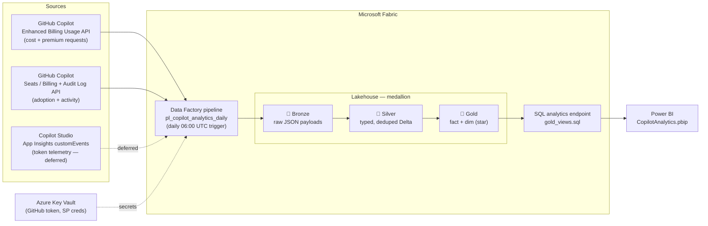
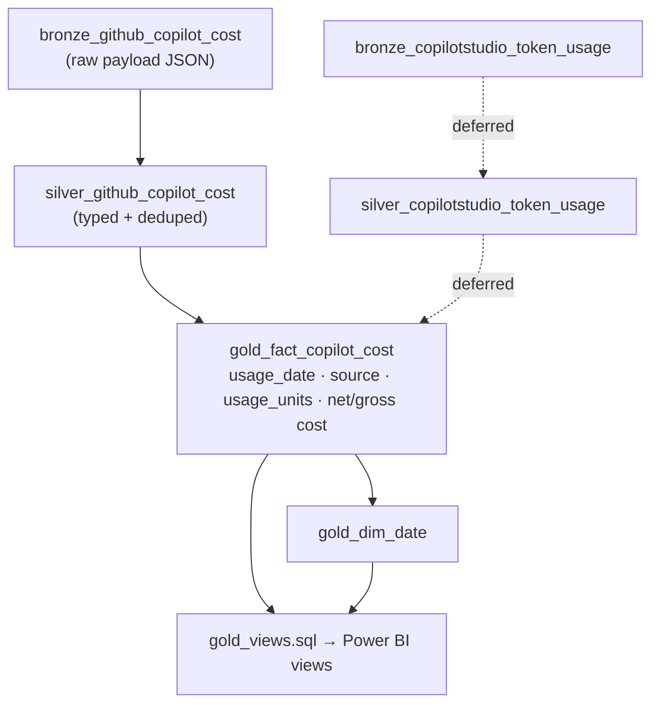
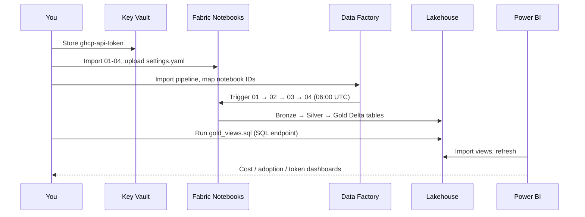

# Architecture & Build Steps — Copilot Fabric Analytics

End-to-end design for extracting **GitHub Copilot** (and, later, **Copilot Studio**)
usage/cost/token telemetry into a **Microsoft Fabric Lakehouse** using the
**medallion architecture** (Bronze → Silver → Gold), surfaced in **Power BI**.

---

## 1. Solution architecture

### Notebook → layer mapping

| Notebook | Reads from | Writes (layer) | Tables |
|----------|-----------|----------------|--------|
| [01_github_cost_usage.py](../src/notebooks/01_github_cost_usage.py) | GitHub Enhanced Billing Usage API | 🥉 Bronze | `bronze_github_copilot_cost` |
| [02_github_seats_audit.py](../src/notebooks/02_github_seats_audit.py) | GitHub Seats/Billing + Audit Log API | 🥉 Bronze | `bronze_github_copilot_seats`, `bronze_github_copilot_audit` |
| [03_copilotstudio_appinsights_tokens.py](../src/notebooks/03_copilotstudio_appinsights_tokens.py) | App Insights `customEvents` | 🥉 Bronze | `bronze_copilotstudio_token_usage` *(skipped while disabled)* |
| [04_transform_silver_gold.py](../src/notebooks/04_transform_silver_gold.py) | Bronze tables | 🥈 Silver + 🥇 Gold | `silver_*`, `gold_fact_copilot_cost`, `gold_dim_date` |

### Data flow across the medallion

---

## 2. What's wired up in this repo

| Concern | Status | Where |
|---------|--------|-------|
| Runtime config | ✅ created (git-ignored) | [config/settings.yaml](../config/settings.yaml) |
| GitHub scope | ✅ `org` (set `github.org`) | `config/settings.yaml` |
| Copilot Studio | ⏸️ deferred (`enabled: false`) | notebook 03 exits cleanly |
| Key Vault | ✅ `kv-copilot-analytics` | `config/settings.yaml` |
| Lookback | ✅ 30 days | `config/settings.yaml` |
| Local config check | ✅ added | [scripts/validate_config.py](../scripts/validate_config.py) |

> Secrets are **never** stored in the repo — only Key Vault **secret names** are referenced.

---

## 3. Build & deploy steps

### Step 0 — Prerequisites
- A **Microsoft Fabric** workspace with a **Lakehouse** created.
- An **Azure Key Vault** added as a **connection** in the Fabric workspace.
- GitHub org with **Copilot Business/Enterprise** (required for the cost/usage/audit APIs).

### Step 1 — Secure access (auth)
1. Create a **GitHub App** (or fine-grained PAT) with read on: *Copilot Business*,
   *Administration*, *Members*, *audit log*.
2. Store the token in Key Vault as **`ghcp-api-token`**.
3. *(Deferred)* For Copilot Studio, register an Entra **service principal** with
   **Reader** on the App Insights resource; store client id/secret in Key Vault.

### Step 2 — Fill in config
- Edit [config/settings.yaml](../config/settings.yaml): set `github.org` to your org login.
- Confirm `key_vault.name` matches your vault.
- Validate locally: `python scripts/validate_config.py`

### Step 3 — Land the code in Fabric
1. Upload `config/settings.yaml` to the Lakehouse **Files** area.
2. Import `src/notebooks/*.py` as Fabric notebooks; **attach each to the Lakehouse**.
3. Run order (manual first pass): `01` → `02` → `03` → `04`.
   - `03` will print *"skipping token telemetry"* while Copilot Studio is disabled.

### Step 4 — Orchestrate
1. Import [pipelines/pl_copilot_analytics_daily.json](../pipelines/pl_copilot_analytics_daily.json)
   into Data Factory.
2. Replace each `<REPLACE_WITH_NOTEBOOK_ID_0x>` and `<REPLACE_WITH_WORKSPACE_ID>`
   with the imported notebook/workspace IDs.
3. Attach [pipelines/trg_copilot_analytics_daily.json](../pipelines/trg_copilot_analytics_daily.json)
   for the daily **06:00 UTC** run.

### Step 5 — Reporting views
- Run [sql/gold_views.sql](../sql/gold_views.sql) against the Lakehouse **SQL analytics endpoint**.

### Step 6 — Power BI
1. Open [powerbi/CopilotAnalytics.pbip](../powerbi/CopilotAnalytics.pbip) in Power BI Desktop.
2. Set parameters: **ServerEndpoint** (Lakehouse SQL endpoint) and **DatabaseName**.
3. Refresh → the Overview page shows cost, adoption %, active seats, and trend.

---

## 4. Deployment sequence (operational view)

---

## 5. Notes & caveats
- **Tokens vs. billed units:** GitHub Copilot bills **premium requests**, not raw LLM
  tokens. True token counts only exist for Copilot Studio via custom App Insights
  telemetry (see [token_telemetry_setup.md](token_telemetry_setup.md)).
- **Personal vs. org Copilot:** the cost/usage/audit APIs are **org/enterprise** features.
  Personal Copilot accounts do not expose them.
- **Re-enabling Copilot Studio:** set `copilot_studio.enabled: true` in `settings.yaml`,
  fill the App Insights `app_id`/`tenant_id`, and notebook 03 + the gold token views
  activate automatically.
